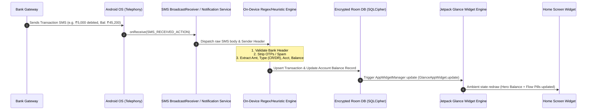
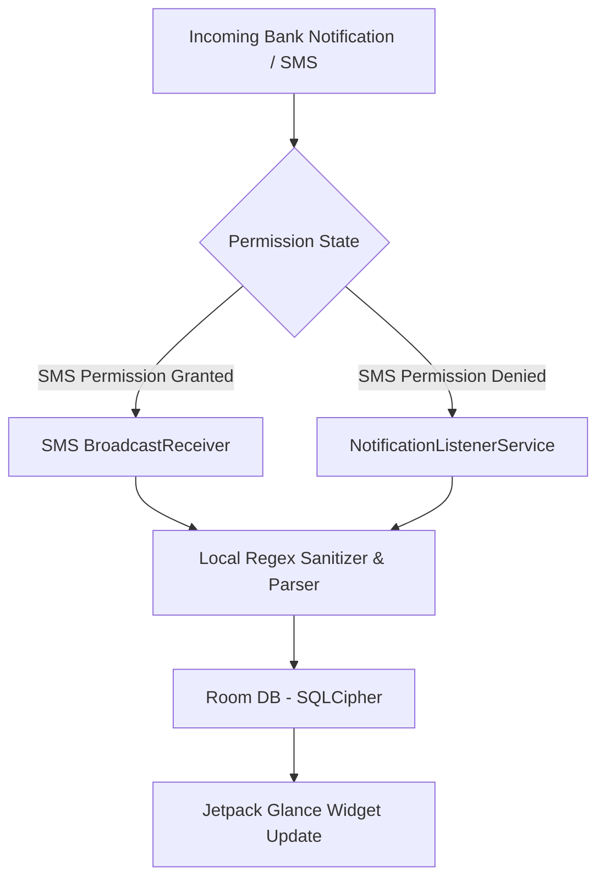

# PRODUCT REQUIREMENTS DOCUMENT (PRD)

**Product Name:** Flow Ledger (Working Title)  
**Document Version:** 1.0.0  
**Status:** Ready for Engineering Review  
**Target Platform:** Android (minSDK 26, targetSDK 35)  
**Author:** Lead Product Manager  

---

## 1. Executive Summary & Core Philosophy

### 1.1 The Anti-Budgeting Philosophy
Traditional personal finance apps fail due to **cognitive overhead and maintenance friction**. Users are forced to manually classify every coffee into "Food & Dining," set arbitrary category budgets, or connect intrusive third-party aggregators that sync bank credentials to the cloud.

**Flow Ledger** is an un-opinionated, ultra-minimalist financial utility built on three strict non-negotiable principles:

```
┌─────────────────────────┐     ┌─────────────────────────┐     ┌─────────────────────────┐
│     Zero User Input     │     │    Pure Volume Focus    │     │      Widget First       │
│  No categorization tags │ ──▶ │ Total Balance + Inflow  │ ──▶ │ Jetpack Glance ambient  │
│    No manual logging    │     │  (Green) / Outflow(Red) │     │    glanceable widget    │
└─────────────────────────┘     └─────────────────────────┘     └─────────────────────────┘
```

1. **Zero User Input:** The app never prompts the user to categorize, tag, or label a transaction. 
2. **Pure Volume Focus:** The interface only tracks total available balance and raw monthly cash flow (Money In [+] vs. Money Out [-]).
3. **Widget-First Experience:** The primary surface is an ambient Android Home Screen widget built with Jetpack Glance. The main app is purely a read-only audit ledger and permission configuration surface.

---

## 2. Product Goals & Non-Goals

### 2.1 Goals
- **Real-Time Automated Ledger:** Update available balance and monthly cash flow metrics within **< 1.5 seconds** of receiving a transaction SMS.
- **Ambient Financial Awareness:** Provide sub-second glanceable insight directly on the Android home screen via Jetpack Glance.
- **Air-Gapped Privacy:** Zero network calls. Total data locality. Complete absence of `android.permission.INTERNET` in `AndroidManifest.xml`.
- **Sub-10MB APK Size & Minimal Battery Footprint:** Ultra-lightweight footprint leveraging modern Android Architecture Components (Room, Coroutines, Glance, Jetpack Compose).

### 2.2 Non-Goals (Explicitly Out of Scope)
- ❌ **Categorization / Tagging:** No "Groceries", "Entertainment", "Utilities", or custom tag engines.
- ❌ **Budgeting Constraints:** No category limits, envelope budgeting, or spend warnings.
- ❌ **Cloud Sync & Multi-Device:** No remote backups, user accounts, login portals, or cloud databases.
- ❌ **Bank API Aggregation:** No Open Banking / Plaid / Salt Edge third-party scraping services.
- ❌ **Investment / Asset Tracking:** No stock, crypto, mutual fund, or net-worth tracking beyond liquid bank balances parsed via SMS.

---

## 3. The Core User Loop (SMS Ingress to Widget Refresh)

The core loop is fully passive, automated, and strictly on-device.



### 3.1 Loop Phase Specifications

| Phase | Component | Latency Target | Description |
| :--- | :--- | :--- | :--- |
| **1. Ingress** | `SmsReceiver : BroadcastReceiver` | $< 100\text{ ms}$ | Receives standard `SMS_RECEIVED_ACTION` intent or fallback `NotificationListenerService` event. |
| **2. Filtering** | `SenderValidator` | $< 20\text{ ms}$ | Verifies sender against country-specific alphanumeric financial sender masks (e.g., `[A-Z]{2}-[A-Z0-9]{6}`). Rejects OTPs and non-financial texts immediately. |
| **3. Parsing** | `DeterministicRegexEngine` | $< 50\text{ ms}$ | Executes compiled regex patterns to extract: Amount ($x$), Flow Direction ($\text{CR} \mid \text{DR}$), Account Identifier ($XXXX$), Timestamp ($t$), and Post-Transaction Balance ($B$). |
| **4. Persistence** | `RoomDatabase` | $< 100\text{ ms}$ | Stores record in encrypted SQLite DB. Computes rolling calendar month aggregates: $\text{Inflow} = \sum \text{Credit}$, $\text{Outflow} = \sum \text{Debit}$. |
| **5. Dispatch** | `FlowGlanceWidgetReceiver` | $< 300\text{ ms}$ | Calls `GlanceAppWidget.update(context, glanceId)` to trigger Compose-to-RemoteViews compilation. |
| **6. Render** | `GlanceAppWidget` | $< 200\text{ ms}$ | Home screen reflects new values with zero app launch required. |

---

## 4. UI/UX Specifications & Constraints

### 4.1 Global Design System & Theming
- **Color Palette:**
  - **Inflow (Money In):** Positive Accent (`#00C853` / Emerald Green `Material 3 Light Container`)
  - **Outflow (Money Out):** Negative Accent (`#D50000` / Crimson Red `Material 3 Light Container`)
  - **Background:** High-contrast neutral (`#121212` Dark / `#F8F9FA` Light / Dynamic Material You Monet Engine).
  - **Typography:** Tabular Figures (`FontFeatureSettings = "tnum"`) to eliminate layout jitter when numeric values change.

---

### 4.2 Jetpack Glance Home Screen Widget (Primary Surface)

The widget is the primary product surface. It supports three layout sizes (2x2, 4x1, and 4x2).

```
+-------------------------------------------------------------+
|  FLOW LEDGER                                      ( 2m ago) |
|                                                             |
|  $ 14,250.80                                                |
|  Current Available Balance                                  |
|                                                             |
|  +---------------------------+ +--------------------------+ |
|  | ▲ +$4,200.00              | | ▼ -$2,180.50             | |
|  | Money In (August)         | | Money Out (August)       | |
|  +---------------------------+ +--------------------------+ |
+-------------------------------------------------------------+
               [ 4x2 Standard Glance Widget ]
```

#### Widget UI Breakdown & Layout Specs:
1. **Header Row:**
   - App title or active account selector pill (`All Accounts` or `Acct ••4092`).
   - Sync heartbeat indicator ("Updated 2m ago" or subtle dot).
   - Privacy Obfuscation Toggle (tap to mask figures with `••••••`).
2. **Hero Balance Display:**
   - Large, prominent typographic treatment (`32sp` - `40sp`, Bold, Tabular numerals).
   - Shows latest known balance aggregate or selected primary account balance.
3. **Monthly Cash Flow Grid (Dual Pill Layout):**
   - **Inflow Card (Left/Top):** 
     - Icon: Upward indicator `▲`
     - Foreground: `#00C853` (Green)
     - Label: "In (Month)"
     - Value: `+$X,XXX.XX`
   - **Outflow Card (Right/Bottom):**
     - Icon: Downward indicator `▼`
     - Foreground: `#D50000` (Red)
     - Label: "Out (Month)"
     - Value: `-$X,XXX.XX`
4. **Glance Engineering Constraints:**
   - **No Heavy Background Threading inside Widget:** Widget state must be read strictly from `GlanceStateDefinition` or instantaneous DataStore cache.
   - **Direct Tap Action:** Tapping the widget opens the Main Ledger screen directly via `actionStartActivity<LedgerActivity>()`.

---

### 4.3 Main Ledger Dashboard (Secondary Audit Surface)

The standalone application exists strictly for auditing parsed transactions and configuring SMS permissions.

```
+-------------------------------------------------------------+
|  Flow Ledger                              [Privacy] [Filter] |
+-------------------------------------------------------------+
|  HERO SUMMARY CARD                                          |
|  Total Balance: $14,250.80                                  |
|  Inflow: +$4,200.00 (Green)  |  Outflow: -$2,180.50 (Red)   |
+-------------------------------------------------------------+
|  TRANSACTIONS (AUGUST 2026)                                 |
|                                                             |
|  TODAY                                                      |
|  [HDFC Bank ••4092]                          -$45.00 (Red)  |
|  POS / Amazon Web Services              Bal: $14,250.80     |
|                                                             |
|  YESTERDAY                                                  |
|  [Chase ••1021]                            +$3,200.00 (Grn) |
|  Direct Deposit / ACME CORP             Bal: $14,295.80     |
|                                                             |
|  22 AUG 2026                                                |
|  [HDFC Bank ••4092]                         -$120.00 (Red)  |
|  UPI / Merchant Payment                 Bal: $11,095.80     |
+-------------------------------------------------------------+
```

#### Strict Ledger Constraints:
- 🚫 **No Category Input Fields:** No transaction editing modal that asks for tags, notes, or categories.
- 🚫 **No Manual "Add Expense" FAB:** Transactions are generated **only** via incoming SMS parser pipeline or manual batch SMS scan.
- ✅ **Permitted User Actions:**
  - **Exclude from Flow:** Swipe to toggle `is_excluded = true` for internal account transfers or self-to-self deposits.
  - **Raw SMS Inspector:** Tap transaction to view the exact, unparsed raw SMS text for data verification.
  - **Account Filter:** Segment by specific bank account or view consolidated flow.

---

## 5. Technical Data Schema & Regex Parsing Engine

### 5.1 SQLite / Room Entity Schema

```sql
-- Accounts Table
CREATE TABLE accounts (
    account_id TEXT PRIMARY KEY NOT NULL, -- e.g. "HDFC_4092"
    bank_name TEXT NOT NULL,              -- e.g. "HDFC Bank"
    account_last4 TEXT NOT NULL,          -- e.g. "4092"
    current_balance REAL NOT NULL,        -- e.g. 14250.80
    last_updated_timestamp INTEGER NOT NULL
);

-- Transactions Table
CREATE TABLE transactions (
    transaction_id TEXT PRIMARY KEY NOT NULL, -- SHA256(sender + timestamp + raw_body)
    account_id TEXT NOT NULL,
    amount REAL NOT NULL,                     -- Always positive float
    flow_direction TEXT NOT NULL,             -- 'INFLOW' or 'OUTFLOW'
    balance_after REAL,                       -- Available balance after tx if provided
    raw_sender TEXT NOT NULL,                 -- e.g. "VK-HDFCBK"
    raw_body TEXT NOT NULL,                   -- Complete original SMS body
    timestamp INTEGER NOT NULL,               -- Epoch timestamp
    is_excluded INTEGER DEFAULT 0,            -- 1 = Excluded from Monthly Flow
    FOREIGN KEY(account_id) REFERENCES accounts(account_id) ON DELETE CASCADE
);
```

### 5.2 Deterministic Parsing Engine Specification

The parser uses a cascade of strict regex pattern rules with named capture groups:

```kotlin
data class ParsedTransaction(
    val amount: Double,
    val flowDirection: FlowDirection, // INFLOW | OUTFLOW
    val accountLast4: String,
    val availableBalance: Double?,
    val timestamp: Long,
    val rawMerchant: String?
)

enum class FlowDirection { INFLOW, OUTFLOW }
```

#### Sample Pattern Matching Matrix:

| Sender Pattern | Sample SMS Format | Direction | Extracted Amount | Extracted Balance |
| :--- | :--- | :--- | :--- | :--- |
| `.*(?:HDFC\|HDFCBK).*` | `Rs 5,400.00 debited from a/c **4092 on 24-08-26. Info: Amazon. Bal: Rs 42,100.50` | `OUTFLOW` | `5400.00` | `42100.50` |
| `.*(?:ICICI\|ICICIB).*` | `Acct XX102 credited with INR 12,000.00 on 23-Aug-26 by Salary. Avl Bal INR 85,400.00` | `INFLOW` | `12000.00` | `85400.00` |
| `.*(?:CHASE).*` | `Chase: You made a $45.20 debit with card ending in 8912. Available balance: $2,410.00` | `OUTFLOW` | `45.20` | `2410.00` |

---

## 6. Data Privacy & Google Play Store Permission Strategy

Handling SMS permissions on Android requires strict adherence to Google Play’s **Permissions and APIs that Access Sensitive Information** policy.

### 6.1 The Permission Barrier: Google Play SMS Policy

Under Google Play policies, access to `RECEIVE_SMS` and `READ_SMS` is restricted exclusively to:
1. **Default SMS Handlers**, or
2. Apps qualifying for an **Explicit Policy Exception** (specifically: *Financial transaction and balance parsing*).

```
┌─────────────────────────────────────────────────────────────────────────────┐
│                    GOOGLE PLAY COMPLIANCE STRATEGY                          │
├─────────────────────────────────────────────────────────────────────────────┤
│  Primary Track:   File Financial SMS Exception Declaration Form             │
│                   Core Feature Requirement: Pure Financial Ledger Utility   │
├─────────────────────────────────────────────────────────────────────────────┤
│  Secondary Track: Notification Listener Service (Zero SMS Permission Fallback) │
│                   Reads bank push notifications if SMS permission denied   │
└─────────────────────────────────────────────────────────────────────────────┘
```

---

### 6.2 The Air-Gapped Architectural Guarantee (Zero Internet Permission)

To achieve unmatched user trust and effortless Google Play approval, Flow Ledger enforces a **hard OS-level air gap**:

```xml
<!-- AndroidManifest.xml -->
<manifest xmlns:android="http://schemas.android.com/apk/res/android"
    package="com.flowledger.app">

    <!-- REQUIRED PERMISSIONS -->
    <uses-permission android:name="android.permission.RECEIVE_SMS" />
    <uses-permission android:name="android.permission.READ_SMS" />

    <!-- ZERO INTERNET PERMISSION:
         Notice android.permission.INTERNET is completely absent.
         The OS makes network socket creation impossible. -->
</manifest>
```

#### Verification & Trust Matrix:
- **No Internet Permission:** The app does **NOT** declare `android.permission.INTERNET`. Even if malicious code or an SDK were injected, the Android Linux kernel refuses network socket allocation (`java.net.SocketException: Permission denied`).
- **No Analytics / Ad SDKs:** Zero Google Analytics, Firebase Crashlytics, Adjust, or AppsFlyer SDKs.
- **SQLCipher at Rest:** Database encrypted using AES-256 with key rooted in Android Keystore (`KeyStoreProvider`).

---

### 6.3 Dual-Path Ingress Strategy (SMS vs. Notification Fallback)

To eliminate single-point-of-failure risk with Play Store reviewers or users reluctant to grant SMS permissions:



1. **Path A (Primary): `RECEIVE_SMS` + `READ_SMS`**
   - Ideal for automatic background capture of all incoming transaction texts.
   - Initial onboarding historical sync: Scans past 90 days of SMS on-device once.
2. **Path B (Fallback): `NotificationListenerService`**
   - Requires `android.permission.BIND_NOTIFICATION_LISTENER_SERVICE`.
   - Parses incoming notifications generated by official banking apps (e.g., Chase, Wells Fargo, Revolut, GPay, PhonePe).
   - Ensures 100% functionality even in regions where banks migrate from SMS to push notifications.

---

### 6.4 Google Play Declaration Submission Blueprint

When submitting to the Play Console, the declaration form must contain the following specific attestations:

| Declaration Field | Standard Submission Response |
| :--- | :--- |
| **Declared Core Functional Use Case** | `Financial transaction parsing and ambient account balance tracking (Personal Finance SMS Exception).` |
| **Why SMS Retriever API / SMS User Consent API is insufficient** | `SMS Retriever API requires the sender (bank) to include an app-specific hash in the SMS. Financial institutions do not embed custom hashes in standard debit/credit transaction alerts. Direct SMS access is the only technical mechanism to read transaction confirmations.` |
| **Data Retention & Privacy Declaration** | `1. All SMS processing occurs strictly on-device in volatile memory.<br/>2. No SMS content is transmitted off-device; the application contains no internet permissions.<br/>3. Non-financial messages (conversations, personal SMS, OTPs) are dropped immediately by the in-memory sender filter.` |

---

## 7. Edge Cases & Reliability Matrix

| Scenario / Edge Case | Failure Mode / Risk | Mitigation & System Behavior |
| :--- | :--- | :--- |
| **OTP / 2FA SMS** | Reading sensitive one-time passwords | **Strict OTP Filter:** Parser checks for tokens like `OTP`, `verification code`, `do not share`, `secret PIN`. These are discarded in memory before any DB write. |
| **Refunds / Reversals** | Erroneous double-deduction | Recognized as `INFLOW` if labeled `Refunded`, `Reversed`, or `Credited Back`. |
| **Self-Transfers (Account A to B)** | Double-counting monthly volume | User can swipe any transaction in Ledger to toggle **"Exclude from Flow"**, which omits the value from Monthly Cash Flow aggregation. |
| **Device Reboot / OS Killing** | Glance widget displays stale balance | `BOOT_COMPLETED` receiver schedules an immediate local DB read to refresh the Glance widget state on startup. |
| **Doze Mode / Deep Sleep** | SMS delivered during Doze | `BroadcastReceiver` executes synchronously inside `goAsync()` with a 5-second wake-budget to guarantee DB persistence and widget update. |
| **Multi-Currency SMS** | Mixing `$` and `₹` in total sum | Store currency symbol with each account. If multiple currencies are detected, Ledger and Widget display segregated flow pills per currency. |

---

## 8. Success Metrics & Release Criteria

### 8.1 Key Performance Indicators (KPIs)
- **Zero-Input Retention:** Day 30 retention $\ge 45\%$ (compared to industry standard $18\%$ for manual expense trackers).
- **Parse Accuracy Rate:** $\ge 98.5\%$ correct extraction of Amount, Direction, and Balance across top 50 national banks.
- **Latency from SMS Receipt to Widget Display:** $\le 1,500\text{ ms}$ (95th percentile).
- **Crash-Free Sessions:** $\ge 99.9\%$.
- **Cold App Launch Time:** $\le 400\text{ ms}$.

### 8.2 Definition of Done (DoD) for MVP
1. Zero network calls proven via Android manifest inspection and network security config test suite.
2. Complete Jetpack Glance widget suite (4x2, 2x2, 4x1) with reactive updates.
3. On-device Regex Engine with 100+ unit test fixtures covering top financial SMS templates.
4. Comprehensive Play Store declaration collateral and fallback Notification Listener implemented.
