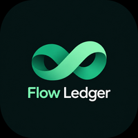

  

# Flow Ledger — Android Financial Utility

> Minimalist, privacy-first personal finance application with zero manual tagging, ambient Glance widgets, and automated SMS parsing.

## 🚀 Overview
**Flow Ledger** is an un-opinionated, ultra-minimalist Android utility designed around an "anti-budgeting" philosophy:
1. **Zero User Input:** No manual tagging or categorization friction.
2. **Pure Cash Volume Focus:** Total available balance and raw cash flow (Money In vs. Money Out).
3. **Widget-First Experience:** Ambient, glanceable home screen widgets built with Jetpack Glance.
4. **100% Offline & Private:** Operates entirely locally with Room/SQLite without third-party cloud aggregators.

## 🛠️ Tech Stack
- **Language:** Kotlin 2.0+
- **UI Framework:** Jetpack Compose & Material 3
- **Widgets:** Jetpack Glance
- **Architecture:** MVVM, Clean Architecture, Kotlin Coroutines & Flows
- **Database:** Room Persistence Library (SQLite)
- **Target Platform:** Android SDK 35 (minSDK 26)

## 📄 Documentation
See [`PRODUCT_REQUIREMENTS_DOCUMENT.md`](./PRODUCT_REQUIREMENTS_DOCUMENT.md) for full design specifications.