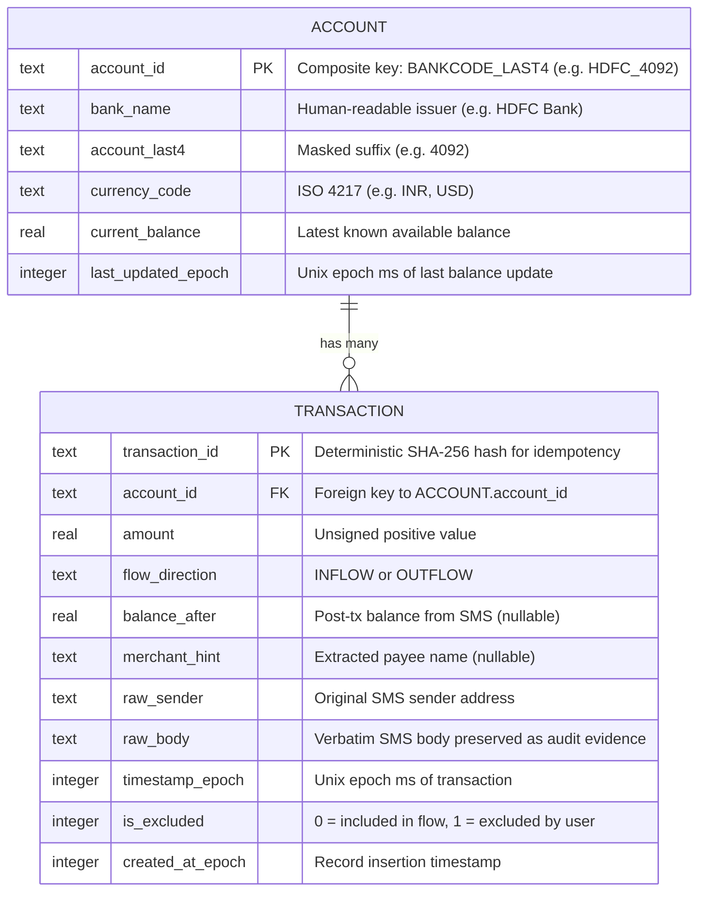
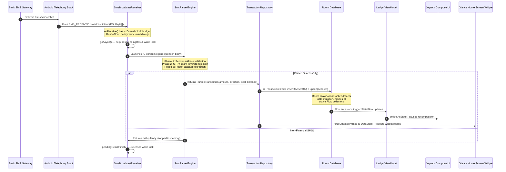
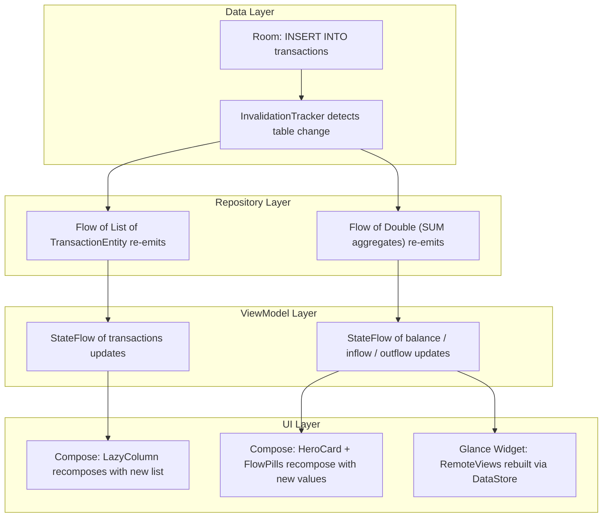
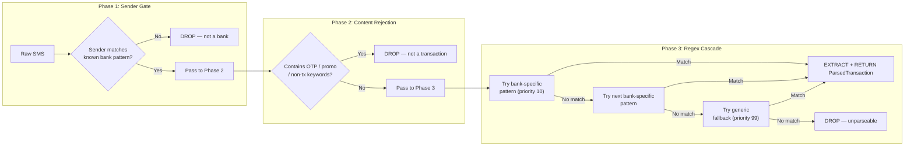
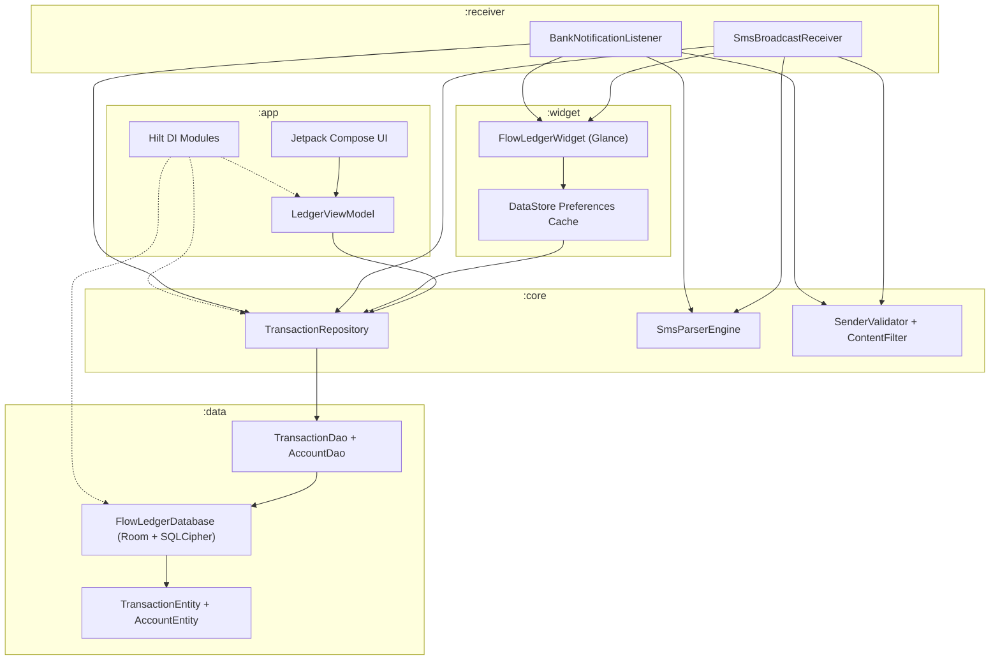

# TECHNICAL ARCHITECTURE DOCUMENT (TAD)

**Product:** Flow Ledger  
**Document Version:** 2.0.0  
**Status:** Ready for Engineering Review  
**Author:** Lead Systems Architect  
**Platform:** Native Android · Kotlin · minSDK 26 · targetSDK 35  

---

## 1. System Architecture Overview

Flow Ledger is a fully offline, single-device Android application. It uses a **unidirectional reactive data flow** architecture built on modern Android Jetpack components.

```
+---------------------------------------------------------------------------+
|                          ANDROID APPLICATION                               |
|                                                                           |
|  +------------------+     +------------------+     +-------------------+  |
|  |  Event Ingress   |     |   Core Engine    |     |    UI Layer       |  |
|  |  (Receivers)     |     |   (Parser +      |     |  (Compose +      |  |
|  |                  |---->|    Repository)    |---->|   Glance Widget) |  |
|  |  BroadcastRecvr  |     |                  |     |                  |  |
|  |  NotifListener   |     |  Room Database   |     |  ViewModel +     |  |
|  +------------------+     +------------------+     |  StateFlow       |  |
|                                                    +-------------------+  |
|                                                                           |
|  +--------------------------------------------------------------------+  |
|  |  SECURITY: No INTERNET permission. Zero network calls. SQLCipher.  |  |
|  +--------------------------------------------------------------------+  |
+---------------------------------------------------------------------------+
```

### Architectural Principles
1. **Unidirectional Data Flow:** Data moves in one direction: `SMS → Parser → Room DB → StateFlow → UI`. No component writes back upstream.
2. **Reactive by Default:** Room emits `Flow<T>` on every table mutation. ViewModels convert these to `StateFlow<T>`. Compose and Glance observe and re-render automatically.
3. **Zero Polling:** No timers, no scheduled refreshes. Every UI update is triggered by an actual database change event.

---

## 2. Entity-Relationship Design (Room Database Schema)

### 2.1 ERD



### 2.2 Design Decisions

| Decision | Rationale |
| :--- | :--- |
| **Deterministic `transaction_id`** via `SHA-256(sender + timestamp + body)` | Guarantees idempotent inserts. Processing the same SMS twice produces the same PK — Room's `OnConflictStrategy.IGNORE` silently drops the duplicate. |
| **`CASCADE` delete on foreign key** | Deleting an account automatically removes all its transactions. Prevents orphaned records. |
| **Composite indices** on `timestamp_epoch`, `flow_direction`, `account_id` | Optimizes the two most frequent queries: monthly aggregate `SUM()` and per-account transaction listing. |
| **`amount` is always positive** | Direction is stored separately in `flow_direction`. This simplifies `SUM()` aggregation — no sign arithmetic needed. |
| **`raw_body` stored immutably** | The original SMS text is preserved verbatim for user auditing and parser debugging. Never modified after insertion. |

### 2.3 Room Entity Definitions

```kotlin
@Entity(tableName = "accounts")
data class AccountEntity(
    @PrimaryKey
    @ColumnInfo(name = "account_id")
    val accountId: String,                    // "HDFC_4092"

    @ColumnInfo(name = "bank_name")
    val bankName: String,                     // "HDFC Bank"

    @ColumnInfo(name = "account_last4")
    val accountLast4: String,                 // "4092"

    @ColumnInfo(name = "currency_code")
    val currencyCode: String = "INR",         // ISO 4217

    @ColumnInfo(name = "current_balance")
    val currentBalance: Double,               // 14250.80

    @ColumnInfo(name = "last_updated_epoch")
    val lastUpdatedEpoch: Long                // System.currentTimeMillis()
)

@Entity(
    tableName = "transactions",
    foreignKeys = [ForeignKey(
        entity = AccountEntity::class,
        parentColumns = ["account_id"],
        childColumns = ["account_id"],
        onDelete = ForeignKey.CASCADE
    )],
    indices = [
        Index("account_id"),
        Index("timestamp_epoch"),
        Index("flow_direction")
    ]
)
data class TransactionEntity(
    @PrimaryKey
    @ColumnInfo(name = "transaction_id")
    val transactionId: String,                // SHA-256 deterministic hash

    @ColumnInfo(name = "account_id")
    val accountId: String,

    @ColumnInfo(name = "amount")
    val amount: Double,                       // Always positive

    @ColumnInfo(name = "flow_direction")
    val flowDirection: String,                // "INFLOW" | "OUTFLOW"

    @ColumnInfo(name = "balance_after")
    val balanceAfter: Double?,                // Nullable if SMS omits it

    @ColumnInfo(name = "merchant_hint")
    val merchantHint: String?,                // "Amazon", "ACME CORP"

    @ColumnInfo(name = "raw_sender")
    val rawSender: String,                    // "VK-HDFCBK"

    @ColumnInfo(name = "raw_body")
    val rawBody: String,                      // Full SMS text (immutable)

    @ColumnInfo(name = "timestamp_epoch")
    val timestampEpoch: Long,

    @ColumnInfo(name = "is_excluded")
    val isExcluded: Boolean = false,

    @ColumnInfo(name = "created_at_epoch")
    val createdAtEpoch: Long = System.currentTimeMillis()
)
```

### 2.4 DAO Interfaces

```kotlin
@Dao
interface TransactionDao {

    /** Live stream of all transactions, newest first. Re-emits on any table change. */
    @Query("SELECT * FROM transactions ORDER BY timestamp_epoch DESC")
    fun observeAll(): Flow<List<TransactionEntity>>

    /** Live stream filtered by account. */
    @Query("SELECT * FROM transactions WHERE account_id = :accountId ORDER BY timestamp_epoch DESC")
    fun observeByAccount(accountId: String): Flow<List<TransactionEntity>>

    /** Live monthly inflow aggregate (excludes user-excluded transactions). */
    @Query("""
        SELECT COALESCE(SUM(amount), 0.0) FROM transactions
        WHERE flow_direction = 'INFLOW'
          AND is_excluded = 0
          AND timestamp_epoch >= :monthStartEpoch
          AND timestamp_epoch <  :monthEndEpoch
    """)
    fun observeMonthlyInflow(monthStartEpoch: Long, monthEndEpoch: Long): Flow<Double>

    /** Live monthly outflow aggregate. */
    @Query("""
        SELECT COALESCE(SUM(amount), 0.0) FROM transactions
        WHERE flow_direction = 'OUTFLOW'
          AND is_excluded = 0
          AND timestamp_epoch >= :monthStartEpoch
          AND timestamp_epoch <  :monthEndEpoch
    """)
    fun observeMonthlyOutflow(monthStartEpoch: Long, monthEndEpoch: Long): Flow<Double>

    /** One-shot snapshot reads (used by Glance widget for non-reactive updates). */
    @Query("""
        SELECT COALESCE(SUM(amount), 0.0) FROM transactions
        WHERE flow_direction = 'INFLOW' AND is_excluded = 0
          AND timestamp_epoch >= :monthStartEpoch AND timestamp_epoch < :monthEndEpoch
    """)
    suspend fun getMonthlyInflowOnce(monthStartEpoch: Long, monthEndEpoch: Long): Double

    @Query("""
        SELECT COALESCE(SUM(amount), 0.0) FROM transactions
        WHERE flow_direction = 'OUTFLOW' AND is_excluded = 0
          AND timestamp_epoch >= :monthStartEpoch AND timestamp_epoch < :monthEndEpoch
    """)
    suspend fun getMonthlyOutflowOnce(monthStartEpoch: Long, monthEndEpoch: Long): Double

    /** Idempotent insert — silently skips if transaction_id already exists. */
    @Insert(onConflict = OnConflictStrategy.IGNORE)
    suspend fun insertIfAbsent(transaction: TransactionEntity): Long

    /** Toggle a transaction's exclusion from monthly flow calculations. */
    @Query("UPDATE transactions SET is_excluded = :excluded WHERE transaction_id = :transactionId")
    suspend fun setExcluded(transactionId: String, excluded: Boolean)
}

@Dao
interface AccountDao {

    @Query("SELECT * FROM accounts ORDER BY last_updated_epoch DESC")
    fun observeAll(): Flow<List<AccountEntity>>

    /** Live aggregate of all account balances. */
    @Query("SELECT COALESCE(SUM(current_balance), 0.0) FROM accounts")
    fun observeTotalBalance(): Flow<Double>

    /** One-shot snapshot for Glance widget. */
    @Query("SELECT COALESCE(SUM(current_balance), 0.0) FROM accounts")
    suspend fun getTotalBalanceOnce(): Double

    /** Insert or update account record (updates balance on every new transaction). */
    @Insert(onConflict = OnConflictStrategy.REPLACE)
    suspend fun upsert(account: AccountEntity)
}
```

---

## 3. Data Flow — SMS_RECEIVED to Widget Render

### 3.1 End-to-End Sequence Diagram



### 3.2 Layer-by-Layer Implementation

#### Layer 0: SMS BroadcastReceiver (Event Ingress)

The `BroadcastReceiver` is Android's mechanism for receiving system-wide events. When an SMS arrives, the OS broadcasts an intent that our receiver intercepts. The critical constraint: `onReceive()` runs on the **main thread** with a ~10-second wall-clock limit. Exceeding it causes an ANR (Application Not Responding) crash.

We immediately call `goAsync()` to acquire a `PendingResult` token — a wake lock that keeps the process alive while a background coroutine finishes the parsing and persistence work.

```kotlin
class SmsBroadcastReceiver : BroadcastReceiver() {

    override fun onReceive(context: Context, intent: Intent) {
        if (intent.action != Telephony.Sms.Intents.SMS_RECEIVED_ACTION) return

        // Extract raw SMS content from PDU (Protocol Data Unit) bytes
        val messages = Telephony.Sms.Intents.getMessagesFromIntent(intent)
        val sender = messages.firstOrNull()?.originatingAddress ?: return
        val body = messages.joinToString("") { it.messageBody ?: "" }

        // Acquire wake lock token — keeps process alive for background work
        val pendingResult = goAsync()

        // Offload to IO dispatcher (main thread is released immediately)
        CoroutineScope(Dispatchers.IO + SupervisorJob()).launch {
            try {
                val appContext = context.applicationContext
                val parser = SmsParserEngine.getInstance()
                val repository = TransactionRepository.getInstance(appContext)

                // Three-phase parse pipeline
                val parsed = parser.parse(sender, body) ?: return@launch

                // Atomic database write
                repository.recordTransaction(parsed, sender, body)

                // Push update to home screen widget
                FlowLedgerWidget.forceUpdate(appContext)
            } finally {
                // Release the wake lock — signals OS that async work is done
                pendingResult.finish()
            }
        }
    }
}
```

**Why `goAsync()` instead of `WorkManager`?**  
`WorkManager` is designed for deferrable work. SMS parsing is **latency-critical** — the PRD requires < 1.5s from SMS receipt to widget update. `goAsync()` gives us a synchronous execution window within the broadcast lifecycle without deferral or batching delays.

---

#### Layer 1: Repository (Data Access + Atomic Writes)

The repository is the single source of truth for all database operations. It coordinates the atomic insertion of a transaction record and the corresponding account balance update within a single Room `@Transaction` block — if either operation fails, both roll back.

```kotlin
class TransactionRepository(
    private val transactionDao: TransactionDao,
    private val accountDao: AccountDao
) {
    /**
     * Atomically persists a parsed transaction and updates the parent account balance.
     * The @Transaction annotation ensures both operations succeed or both roll back.
     */
    @androidx.room.Transaction
    suspend fun recordTransaction(
        parsed: ParsedTransaction,
        rawSender: String,
        rawBody: String
    ) {
        // 1. Generate deterministic primary key for idempotent inserts
        val txId = hashOf(rawSender, parsed.timestamp, rawBody)

        // 2. Insert transaction (silently ignored if duplicate SHA-256 key exists)
        val entity = TransactionEntity(
            transactionId = txId,
            accountId = "${parsed.bankCode}_${parsed.accountLast4}",
            amount = parsed.amount,
            flowDirection = parsed.flowDirection.name,
            balanceAfter = parsed.availableBalance,
            merchantHint = parsed.merchantHint,
            rawSender = rawSender,
            rawBody = rawBody,
            timestampEpoch = parsed.timestamp
        )
        transactionDao.insertIfAbsent(entity)

        // 3. Update account with latest known balance
        if (parsed.availableBalance != null) {
            accountDao.upsert(
                AccountEntity(
                    accountId = entity.accountId,
                    bankName = parsed.bankName,
                    accountLast4 = parsed.accountLast4,
                    currencyCode = parsed.currencyCode,
                    currentBalance = parsed.availableBalance,
                    lastUpdatedEpoch = System.currentTimeMillis()
                )
            )
        }
        // After commit, Room's InvalidationTracker automatically notifies
        // all active Flow<> collectors — no manual refresh needed.
    }

    // --- Live reactive streams (used by ViewModel) ---
    fun observeTransactions(): Flow<List<TransactionEntity>> =
        transactionDao.observeAll()

    fun observeTotalBalance(): Flow<Double> =
        accountDao.observeTotalBalance()

    fun observeMonthlyInflow(start: Long, end: Long): Flow<Double> =
        transactionDao.observeMonthlyInflow(start, end)

    fun observeMonthlyOutflow(start: Long, end: Long): Flow<Double> =
        transactionDao.observeMonthlyOutflow(start, end)

    // --- One-shot snapshots (used by Glance widget) ---
    suspend fun getTotalBalanceOnce(): Double = accountDao.getTotalBalanceOnce()
    suspend fun getMonthlyInflowOnce(s: Long, e: Long): Double = transactionDao.getMonthlyInflowOnce(s, e)
    suspend fun getMonthlyOutflowOnce(s: Long, e: Long): Double = transactionDao.getMonthlyOutflowOnce(s, e)

    suspend fun setExcluded(txId: String, excluded: Boolean) =
        transactionDao.setExcluded(txId, excluded)
}
```

---

#### Layer 2: ViewModel (Reactive State Holder)

The ViewModel converts Room's `Flow<T>` emissions into `StateFlow<T>` — a hot, lifecycle-aware observable that Compose UI collects. When Room detects a table mutation, the Flow re-emits, the StateFlow updates, and every Composable observing it recomposes automatically.

```kotlin
@HiltViewModel
class LedgerViewModel @Inject constructor(
    private val repository: TransactionRepository
) : ViewModel() {

    private val _monthRange = MutableStateFlow(currentMonthRange())

    /** Total balance across all accounts — updates reactively on any account change. */
    val totalBalance: StateFlow<Double> = repository
        .observeTotalBalance()
        .stateIn(viewModelScope, SharingStarted.WhileSubscribed(5000), 0.0)

    /** Monthly inflow — recomputes when month range changes or new credits arrive. */
    val monthlyInflow: StateFlow<Double> = _monthRange
        .flatMapLatest { (start, end) -> repository.observeMonthlyInflow(start, end) }
        .stateIn(viewModelScope, SharingStarted.WhileSubscribed(5000), 0.0)

    /** Monthly outflow — same reactive behavior as inflow. */
    val monthlyOutflow: StateFlow<Double> = _monthRange
        .flatMapLatest { (start, end) -> repository.observeMonthlyOutflow(start, end) }
        .stateIn(viewModelScope, SharingStarted.WhileSubscribed(5000), 0.0)

    /** Full transaction list — newest first. */
    val transactions: StateFlow<List<TransactionEntity>> = repository
        .observeTransactions()
        .stateIn(viewModelScope, SharingStarted.WhileSubscribed(5000), emptyList())

    /** User action: exclude/include a transaction from monthly flow calculation. */
    fun toggleExcluded(transactionId: String, excluded: Boolean) {
        viewModelScope.launch {
            repository.setExcluded(transactionId, excluded)
            // No manual UI refresh — Room's InvalidationTracker re-emits
            // the monthly aggregate Flows, which updates StateFlow,
            // which triggers Compose recomposition.
        }
    }
}
```

---

#### Layer 3: Jetpack Compose UI (Reactive Rendering)

Compose is a declarative UI framework. The `collectAsState()` call subscribes a Composable to a `StateFlow`. When the StateFlow emits a new value, Compose's runtime diffs the composition tree and patches only the changed nodes — no manual `notifyDataSetChanged()` or `invalidate()` calls.

```kotlin
@Composable
fun LedgerDashboard(viewModel: LedgerViewModel = hiltViewModel()) {
    val balance   by viewModel.totalBalance.collectAsState()
    val inflow    by viewModel.monthlyInflow.collectAsState()
    val outflow   by viewModel.monthlyOutflow.collectAsState()
    val txnList   by viewModel.transactions.collectAsState()

    Column(modifier = Modifier.fillMaxSize()) {
        HeroBalanceCard(balance = balance)

        Row(horizontalArrangement = Arrangement.SpaceEvenly) {
            FlowPill(label = "In", amount = inflow, color = InflowGreen)
            FlowPill(label = "Out", amount = outflow, color = OutflowRed)
        }

        LazyColumn {
            val grouped = txnList.groupBy { it.timestampEpoch.toLocalDate() }
            grouped.forEach { (date, items) ->
                stickyHeader { DateHeader(date) }
                items(items, key = { it.transactionId }) { txn ->
                    TransactionRow(
                        transaction = txn,
                        onSwipeExclude = {
                            viewModel.toggleExcluded(txn.transactionId, !txn.isExcluded)
                        }
                    )
                }
            }
        }
    }
}
```

### 3.3 Reactive State Propagation — How a Single INSERT Updates Everything



**No layer ever polls.** Every layer is a reactive subscriber to the layer below it. A single `INSERT` in Room triggers a cascade: `InvalidationTracker → Flow re-emission → StateFlow update → Compose recomposition → Glance rebuild`. Zero manual refresh calls anywhere in the stack.

---

## 4. Glance Widget — Cross-Process State Management

The Glance widget runs in the **Launcher's process**, not the app's process. It cannot access Room or StateFlow directly. Instead, it reads from a `DataStore<Preferences>` cache that the app process writes to after each transaction.

```kotlin
data class WidgetState(
    val totalBalance: Double = 0.0,
    val monthlyInflow: Double = 0.0,
    val monthlyOutflow: Double = 0.0,
    val currencySymbol: String = "INR",
    val lastUpdatedEpoch: Long = 0L,
    val isObfuscated: Boolean = false
)

class FlowLedgerWidget : GlanceAppWidget() {

    override val stateDefinition = PreferencesGlanceStateDefinition

    override suspend fun provideGlance(context: Context, id: GlanceId) {
        provideContent {
            val prefs = currentState<Preferences>()
            val state = WidgetState(
                totalBalance = prefs[BALANCE_KEY] ?: 0.0,
                monthlyInflow = prefs[INFLOW_KEY] ?: 0.0,
                monthlyOutflow = prefs[OUTFLOW_KEY] ?: 0.0,
                currencySymbol = prefs[CURRENCY_KEY] ?: "INR",
                lastUpdatedEpoch = prefs[UPDATED_KEY] ?: 0L,
                isObfuscated = prefs[OBFUSCATED_KEY] ?: false
            )
            WidgetContent(state)
        }
    }

    companion object {
        /** Called from BroadcastReceiver after persisting a transaction. */
        suspend fun forceUpdate(context: Context) {
            val repo = TransactionRepository.getInstance(context)
            val (monthStart, monthEnd) = currentMonthRange()

            val balance = repo.getTotalBalanceOnce()
            val inflow  = repo.getMonthlyInflowOnce(monthStart, monthEnd)
            val outflow = repo.getMonthlyOutflowOnce(monthStart, monthEnd)

            // Write snapshot to DataStore (cross-process readable)
            updateAppWidgetState(context, PreferencesGlanceStateDefinition) { prefs ->
                prefs.toMutablePreferences().apply {
                    this[BALANCE_KEY]  = balance
                    this[INFLOW_KEY]   = inflow
                    this[OUTFLOW_KEY]  = outflow
                    this[UPDATED_KEY]  = System.currentTimeMillis()
                }
            }

            // Trigger re-render of all placed widget instances
            FlowLedgerWidget().updateAll(context)
        }
    }
}
```

---

## 5. Regex Parsing Engine — Extracting Structure from Unstructured SMS

### 5.1 The Problem

Bank SMS messages have **no standard format**. Every bank, in every country, writes transaction alerts differently:

```
HDFC:  "Rs 5,400.00 debited from a/c **4092 on 24-08-26. Bal: Rs 42,100"
ICICI: "Acct XX102 credited with INR 12,000.00. Avl Bal INR 85,400.00"
SBI:   "Your a/c X3210 Debited Rs. 245.00 Avl Bal Rs. 14020.56"
Chase: "You made a $45.20 debit with card ending in 8912. Balance: $2,410"
Axis:  "INR 1,200.00 sent to JOHN via UPI. UPI Ref: 423100. Bal 5400.00"
```

From each of these, we must deterministically extract:

| Field | Type | Example |
| :--- | :--- | :--- |
| `amount` | `Double` | `5400.00` |
| `flowDirection` | `Enum` | `INFLOW` or `OUTFLOW` |
| `accountLast4` | `String` | `"4092"` |
| `availableBalance` | `Double?` | `42100.50` (nullable — not all SMS include it) |

### 5.2 Three-Phase Pipeline Architecture



---

#### Phase 1: Sender Address Gating

Cheapest filter — runs first. Indian bank SMS senders follow TRAI's alphanumeric format (`XX-YYYYYY`). US banks use short codes or branded sender names.

```kotlin
object SenderValidator {

    // Indian TRAI format: 2-letter prefix + hyphen + 3-6 letter bank code
    // Examples: VK-HDFCBK, AD-ICICIB, JM-SBIBNK, BP-AXISBK
    private val INDIA_BANK_SENDER = Regex(
        "^[A-Z]{2}-[A-Z]{3,6}(?:BK|BN|BNK|IN)?$",
        RegexOption.IGNORE_CASE
    )

    // Known US bank short codes and alphanumeric senders
    private val KNOWN_BANK_SENDERS = setOf(
        "72166",   // Chase
        "32552",   // Bank of America
        "86434",   // Wells Fargo
        "AMEX", "CITI"
    )

    fun isBankSender(sender: String): Boolean {
        val cleaned = sender.trim().uppercase()
        return INDIA_BANK_SENDER.matches(cleaned)
            || KNOWN_BANK_SENDERS.any { cleaned.contains(it) }
    }
}
```

---

#### Phase 2: OTP and Promotional SMS Rejection

Even valid bank senders send non-transaction messages (OTPs, offers, KYC reminders). This negative-keyword filter runs before the expensive regex cascade.

```kotlin
object ContentFilter {

    private val REJECTION_KEYWORDS = listOf(
        "otp", "one.time.password", "verification.code",
        "do not share", "don't share", "secret pin",
        "cvv", "expiry",
        "apply now", "limited offer", "cashback offer",
        "emi due", "payment reminder", "auto.debit.*due",
        "password changed", "profile updated", "registered",
        "dear customer.*nominee", "kyc"
    )

    private val rejectionPattern = Regex(
        REJECTION_KEYWORDS.joinToString("|") { "(?:$it)" },
        RegexOption.IGNORE_CASE
    )

    /** Returns true if the message should be DROPPED (not a transaction). */
    fun shouldReject(body: String): Boolean = rejectionPattern.containsMatchIn(body)
}
```

---

#### Phase 3: Priority-Ordered Regex Cascade

The core engine. Each rule is a `(SenderMatcher, BodyRegex)` pair with **named capture groups**. Rules are evaluated in priority order — bank-specific rules fire first (priority 10), generic fallback fires last (priority 99).

```kotlin
data class ParsedTransaction(
    val amount: Double,
    val flowDirection: FlowDirection,
    val accountLast4: String,
    val availableBalance: Double?,
    val bankCode: String,
    val bankName: String,
    val currencyCode: String,
    val merchantHint: String?,
    val timestamp: Long
)

enum class FlowDirection { INFLOW, OUTFLOW }

class SmsParserEngine private constructor() {

    private data class ParserRule(
        val id: String,
        val bankCode: String,
        val bankName: String,
        val currencyCode: String,
        val senderPattern: Regex,
        val bodyPattern: Regex,
        val directionResolver: (MatchResult) -> FlowDirection,
        val priority: Int
    )

    private val rules: List<ParserRule> = listOf(

        // ── HDFC Bank (India) ──────────────────────────────────
        // "Rs 5,400.00 debited from a/c **4092 on 24-08-26.
        //  Info: Amazon. Avl Bal: Rs 42,100.50"
        ParserRule(
            id = "HDFC_V1",
            bankCode = "HDFC", bankName = "HDFC Bank", currencyCode = "INR",
            senderPattern = Regex("(?i).*(?:HDFC|HDFCBK).*"),
            bodyPattern = Regex(
                """(?i)Rs\.?\s*(?<amount>[\d,]+\.?\d*)\s+""" +
                """(?<direction>debited|credited)\s+""" +
                """(?:from|to)\s+a/?c\s*\**(?<acct>\d{4})""" +
                """.*?(?:(?:Avl\s*)?Bal[:\s]*Rs\.?\s*(?<balance>[\d,]+\.?\d*))?"""
            ),
            directionResolver = { m ->
                if (m.groups["direction"]!!.value.contains("credit", true))
                    FlowDirection.INFLOW else FlowDirection.OUTFLOW
            },
            priority = 10
        ),

        // ── ICICI Bank (India) ─────────────────────────────────
        // "Acct XX102 credited with INR 12,000.00 on 23-Aug-26
        //  by Salary. Avl Bal INR 85,400.00"
        ParserRule(
            id = "ICICI_V1",
            bankCode = "ICICI", bankName = "ICICI Bank", currencyCode = "INR",
            senderPattern = Regex("(?i).*(?:ICICI|ICICIB).*"),
            bodyPattern = Regex(
                """(?i)Acct\s*[Xx*]*(?<acct>\d{3,4})\s+""" +
                """(?<direction>credited|debited)\s+""" +
                """(?:with\s+)?(?:INR|Rs\.?)\s*(?<amount>[\d,]+\.?\d*)""" +
                """.*?(?:Avl\s*Bal\s*(?:INR|Rs\.?)\s*(?<balance>[\d,]+\.?\d*))?"""
            ),
            directionResolver = { m ->
                if (m.groups["direction"]!!.value.contains("credit", true))
                    FlowDirection.INFLOW else FlowDirection.OUTFLOW
            },
            priority = 10
        ),

        // ── SBI (State Bank of India) ──────────────────────────
        // "Your a/c X3210 Debited Rs. 245.00 on 24Aug
        //  Tfr to JOHN. Avl Bal Rs. 14,020.56"
        ParserRule(
            id = "SBI_V1",
            bankCode = "SBI", bankName = "State Bank of India", currencyCode = "INR",
            senderPattern = Regex("(?i).*(?:SBI|SBIBNK|SBIIN).*"),
            bodyPattern = Regex(
                """(?i)a/?c\s*[Xx*]*(?<acct>\d{4})\s*""" +
                """(?<direction>Debited|Credited)\s*""" +
                """Rs\.?\s*(?<amount>[\d,]+\.?\d*)""" +
                """.*?(?:(?:Avl\s*)?Bal\s*Rs\.?\s*(?<balance>[\d,]+\.?\d*))?"""
            ),
            directionResolver = { m ->
                if (m.groups["direction"]!!.value.contains("credit", true))
                    FlowDirection.INFLOW else FlowDirection.OUTFLOW
            },
            priority = 10
        ),

        // ── Axis Bank (India) — UPI / IMPS ─────────────────────
        // "INR 1,200.00 sent from A/c no. XX4501 to JOHN VIA UPI.
        //  UPI Ref 423100842. Bal 5,400.00"
        ParserRule(
            id = "AXIS_V1",
            bankCode = "AXIS", bankName = "Axis Bank", currencyCode = "INR",
            senderPattern = Regex("(?i).*(?:AXIS|AXISBK).*"),
            bodyPattern = Regex(
                """(?i)(?:INR|Rs\.?)\s*(?<amount>[\d,]+\.?\d*)\s+""" +
                """(?<direction>sent|received|debited|credited)""" +
                """.*?(?:a/?c\s*(?:no\.?\s*)?[Xx*]*(?<acct>\d{4}))""" +
                """.*?(?:Bal\.?\s*(?:INR|Rs\.?)?\s*(?<balance>[\d,]+\.?\d*))?"""
            ),
            directionResolver = { m ->
                val d = m.groups["direction"]!!.value.lowercase()
                if (d.contains("received") || d.contains("credited"))
                    FlowDirection.INFLOW else FlowDirection.OUTFLOW
            },
            priority = 10
        ),

        // ── Chase Bank (US) ────────────────────────────────────
        // "Chase: You made a $45.20 debit card purchase with card
        //  ending in 8912. Available balance: $2,410.00"
        ParserRule(
            id = "CHASE_V1",
            bankCode = "CHASE", bankName = "Chase", currencyCode = "USD",
            senderPattern = Regex("(?i).*(?:CHASE|72166).*"),
            bodyPattern = Regex(
                """(?i)\$\s*(?<amount>[\d,]+\.?\d*)""" +
                """.*?(?<direction>debit|purchase|withdrawal|deposit|credit|refund)""" +
                """.*?(?:(?:card|account)\s*(?:ending\s*(?:in\s*)?)?(?<acct>\d{4}))""" +
                """.*?(?:(?:Available\s*)?[Bb]alance[:\s]*\$\s*(?<balance>[\d,]+\.?\d*))?"""
            ),
            directionResolver = { m ->
                val d = m.groups["direction"]!!.value.lowercase()
                if (d.contains("deposit") || d.contains("credit") || d.contains("refund"))
                    FlowDirection.INFLOW else FlowDirection.OUTFLOW
            },
            priority = 10
        ),

        // ── GENERIC FALLBACK ───────────────────────────────────
        // Catches unknown banks using universal debit/credit keywords.
        // Only fires if no bank-specific rule matched above.
        ParserRule(
            id = "GENERIC_FALLBACK",
            bankCode = "UNKNOWN", bankName = "Unknown Bank", currencyCode = "INR",
            senderPattern = Regex(".*"),
            bodyPattern = Regex(
                """(?i)(?:(?:Rs\.?|INR|\$|USD|EUR|GBP)""" +
                """\s*(?<amount>[\d,]+\.?\d*)|""" +
                """(?<amount2>[\d,]+\.?\d*)\s*(?:Rs\.?|INR|\$|USD|EUR|GBP))""" +
                """.*?(?<direction>debit|credit|sent|received|withdraw|deposit|purchase|refund|reversed)""" +
                """.*?(?:[Xx*]{2,}(?<acct>\d{4}))""" +
                """.*?(?:(?:Avl\.?\s*)?[Bb]al(?:ance)?[:\s]*(?:Rs\.?|INR|\$|USD|EUR|GBP)?\s*(?<balance>[\d,]+\.?\d*))?"""
            ),
            directionResolver = { m ->
                val d = m.groups["direction"]!!.value.lowercase()
                if (d.contains("credit") || d.contains("received") ||
                    d.contains("deposit") || d.contains("refund") || d.contains("reversed"))
                    FlowDirection.INFLOW else FlowDirection.OUTFLOW
            },
            priority = 99
        ),
    ).sortedBy { it.priority }

    fun parse(sender: String, body: String): ParsedTransaction? {
        if (!SenderValidator.isBankSender(sender)) return null   // Phase 1
        if (ContentFilter.shouldReject(body)) return null         // Phase 2

        for (rule in rules) {                                     // Phase 3
            if (!rule.senderPattern.matches(sender)) continue
            val match = rule.bodyPattern.find(body) ?: continue

            val rawAmount = (match.groups["amount"] ?: match.groups["amount2"])?.value ?: continue
            val amount = rawAmount.replace(",", "").toDoubleOrNull() ?: continue
            if (amount <= 0.0) continue

            val acct = match.groups["acct"]?.value ?: "0000"
            val bal = match.groups["balance"]?.value?.replace(",", "")?.toDoubleOrNull()

            return ParsedTransaction(
                amount = amount,
                flowDirection = rule.directionResolver(match),
                accountLast4 = acct,
                availableBalance = bal,
                bankCode = rule.bankCode,
                bankName = rule.bankName,
                currencyCode = rule.currencyCode,
                merchantHint = extractMerchantHint(body),
                timestamp = System.currentTimeMillis()
            )
        }
        return null
    }

    private fun extractMerchantHint(body: String): String? {
        val patterns = listOf(
            Regex("""(?i)(?:Info|Ref|at|to|from|VIA)\s*[:\-]?\s*([A-Za-z0-9\s&.']+?)(?:\s*(?:on|Ref|UPI|IMPS|NEFT|\.|$))"""),
            Regex("""(?i)(?:towards|for)\s+([A-Za-z0-9\s&.']+?)(?:\s*(?:on|via|\.|$))"""),
        )
        for (p in patterns) {
            val m = p.find(body)
            if (m != null) return m.groupValues[1].trim().take(50)
        }
        return null
    }

    companion object {
        @Volatile private var INSTANCE: SmsParserEngine? = null
        fun getInstance(): SmsParserEngine =
            INSTANCE ?: synchronized(this) {
                INSTANCE ?: SmsParserEngine().also { INSTANCE = it }
            }
    }
}
```

### 5.3 Traced Walkthrough — HDFC Debit SMS

```
INPUT
  Sender:  "VK-HDFCBK"
  Body:    "Rs 5,400.00 debited from a/c **4092 on 24-08-26.
            Info: Amazon. Avl Bal: Rs 42,100.50"

PHASE 1: SENDER GATE
  Pattern: ^[A-Z]{2}-[A-Z]{3,6}(?:BK|BN|BNK|IN)?$
  "VK-HDFCBK" --> MATCH
  Result: PASS

PHASE 2: CONTENT REJECTION
  Check OTP/promo keywords against body --> NO MATCH
  Result: PASS

PHASE 3: REGEX CASCADE
  Rule HDFC_V1 (priority 10):
    Sender check: "VK-HDFCBK" matches (?i).*(?:HDFC|HDFCBK).* --> YES
    Body regex applied:

    Named capture groups extracted:
    +-------------+------------------+-----------------------------+
    | Group       | Raw Capture      | Parsed Value                |
    +-------------+------------------+-----------------------------+
    | amount      | "5,400.00"       | 5400.00 (Double)            |
    | direction   | "debited"        | FlowDirection.OUTFLOW       |
    | acct        | "4092"           | "4092" (String)             |
    | balance     | "42,100.50"      | 42100.50 (Double)           |
    +-------------+------------------+-----------------------------+

OUTPUT
  ParsedTransaction(
      amount = 5400.00,
      flowDirection = OUTFLOW,
      accountLast4 = "4092",
      availableBalance = 42100.50,
      bankCode = "HDFC",
      bankName = "HDFC Bank",
      currencyCode = "INR",
      merchantHint = "Amazon"
  )
```

### 5.4 Unit Tests

```kotlin
@Test
fun `HDFC debit extracts all fields correctly`() {
    val result = engine.parse(
        "VK-HDFCBK",
        "Rs 5,400.00 debited from a/c **4092 on 24-08-26. Info: Amazon. Avl Bal: Rs 42,100.50"
    )
    assertNotNull(result)
    assertEquals(5400.00, result!!.amount, 0.01)
    assertEquals(FlowDirection.OUTFLOW, result.flowDirection)
    assertEquals("4092", result.accountLast4)
    assertEquals(42100.50, result.availableBalance!!, 0.01)
}

@Test
fun `ICICI credit extracts correctly`() {
    val result = engine.parse(
        "AD-ICICIB",
        "Acct XX102 credited with INR 12,000.00 on 23-Aug-26 by Salary. Avl Bal INR 85,400.00"
    )
    assertNotNull(result)
    assertEquals(12000.00, result!!.amount, 0.01)
    assertEquals(FlowDirection.INFLOW, result.flowDirection)
}

@Test
fun `Chase USD debit with balance`() {
    val result = engine.parse(
        "72166",
        "Chase: You made a \$45.20 debit card purchase with card ending in 8912. Available balance: \$2,410.00"
    )
    assertNotNull(result)
    assertEquals(45.20, result!!.amount, 0.01)
    assertEquals(FlowDirection.OUTFLOW, result.flowDirection)
    assertEquals("USD", result.currencyCode)
    assertEquals(2410.00, result.availableBalance!!, 0.01)
}

@Test
fun `OTP from valid bank sender is rejected`() {
    assertNull(engine.parse(
        "VK-HDFCBK",
        "Your OTP for transaction is 482910. Do not share with anyone."
    ))
}

@Test
fun `Personal SMS from phone number is rejected`() {
    assertNull(engine.parse(
        "+919876543210",
        "Hey, I credited Rs 5000 to your account."
    ))
}
```

---

## 6. Module Dependency Graph



---

## 7. Security Architecture

| Layer | Mechanism | What It Prevents |
| :--- | :--- | :--- |
| **OS-Level Air Gap** | `android.permission.INTERNET` is **absent** from manifest. Linux kernel denies all `socket()` syscalls. | Data exfiltration — even injected code cannot open network connections. |
| **In-Memory Sanitization** | Non-financial SMS (OTPs, personal texts, promos) are discarded in volatile memory before any disk I/O. | Sensitive non-financial data never touches persistent storage. |
| **Encryption at Rest** | Room DB encrypted via SQLCipher (AES-256-CBC). Key stored in Android Keystore hardware (TEE/StrongBox). | Physical device theft — database is unreadable without hardware-bound key. |
| **Minimal Attack Surface** | Zero third-party SDKs. No exported components beyond the SMS receiver. No ContentProvider. | Supply-chain attacks, inter-app data leaks, SDK-based telemetry. |

---

## 8. Technology Stack

| Layer | Technology | Version |
| :--- | :--- | :--- |
| Language | Kotlin | 2.0+ |
| UI (App) | Jetpack Compose + Material 3 | BOM 2025.01+ |
| UI (Widget) | Jetpack Glance | 1.1+ |
| Persistence | Room + SQLCipher | Room 2.7+ |
| Async / Reactive | Kotlin Coroutines + Flow | 1.9+ |
| Dependency Injection | Hilt (Dagger) | 2.52+ |
| State Management | StateFlow + DataStore | Kotlin Coroutines |
| Event Ingress | BroadcastReceiver + NotificationListenerService | Android SDK 26+ |
| Testing | JUnit 5 + Turbine (Flow testing) | Latest |
